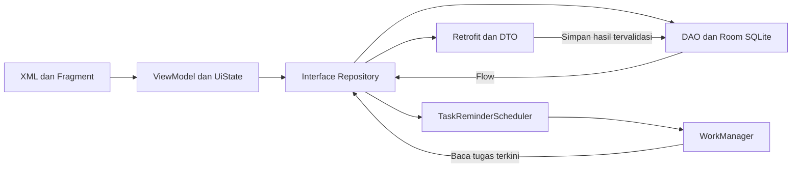

# Arsitektur PaduKampus

Package dan application ID: `com.unpad.padukampus`. Baseline build tetap Kotlin 2.1.20, AGP 8.9.2, Gradle 8.11.1, KSP 2.1.20-1.0.32, SDK 35/35/26, XML dan Material Components, Room 2.7.1, Retrofit 2.11.0/Gson, Navigation 2.8.9, dan WorkManager 2.10.0. View Binding serta Safe Args Kotlin aktif.

## Arah dependensi dan sumber data

Fragment merender state dan meneruskan aksi. Fragment tidak mengakses database, DAO, Retrofit, SharedPreferences, atau WorkManager secara langsung. `di/AppContainer.kt` membuat satu instance setiap dependency dan menyediakan factory ViewModel. Semua ViewModel menerima interface repository; pengujian dapat menggantinya dengan fake tanpa Android database.

Room adalah sumber data utama jadwal, tugas, lokasi kampus, dan cuaca yang ditampilkan. HTTP hanya memperbarui cache Room; respons DTO tidak dikirim langsung ke layar. Koordinat merupakan pengaturan perangkat dan disimpan di SharedPreferences melalui `KampusRepository`, bukan dari Fragment. Tidak ada tabel kedelapan atau data kampus fiktif.

`StateFlow` menggunakan `WhileSubscribed` untuk observasi UI. Fragment memakai `repeatOnLifecycle` dengan `viewLifecycleOwner` dan melepaskan binding/adapter saat view dihancurkan. Form tugas, filter tugas, tanggal jadwal, dan draf koordinat memakai `SavedStateHandle`. Error pembaruan jaringan tidak menghapus data lokal.

## Kontrak repository

| Interface | Kontrak yang dipakai frontend |
|---|---|
| KampusRepository | Flow gedung, pencarian ruangan beserta gedung, koordinat terverifikasi, dan penyimpanan lokasi |
| JadwalRepository | Jadwal efektif per tanggal, kelas berikutnya setelah override, mata kuliah, penyimpanan jadwal/perubahan |
| TugasRepository | Daftar/filter tugas beserta mata kuliah, baca tugas, simpan, selesai, soft delete, rekonsiliasi pengingat |
| CuacaRepository | Observe cache Room per koordinat dan refresh jaringan terpisah; refresh mengembalikan status, bukan DTO |

Interface dan implementasi awal berada di file domain yang sama (`data/repository/*Repository.kt`), tetapi frontend hanya memakai interface. Perubahan signature/model kontrak wajib dikoordinasikan melalui PR sebelum backend atau frontend mengubah pemanggilnya.

`AppResult` membedakan Loading, Success dan Error, dengan dukungan data tersimpan. Tidak ada kredensial atau API key. `CloudSyncManager` adalah kontrak minggu 3; implementasi saat ini secara eksplisit mengembalikan pesan belum tersedia.

## Database dan relasi

Tujuh tabel dipertahankan: `gedung`, `ruangan`, `mata_kuliah`, `jadwal`, `perubahan_jadwal`, `tugas`, `cache_cuaca`. Nama properti Kotlin menjadi camelCase menggunakan `@ColumnInfo` untuk menjaga nama kolom SQLite lama. Empat entitas pribadi memiliki `updated_at`, `sync_status`, `is_deleted`; gedung/ruangan adalah data referensi, cuaca adalah cache lokal.

`JadwalDetail` memuat mata kuliah, ruangan beserta gedung, dan daftar perubahan beserta lokasi penggantinya. `TugasDetail` memuat tugas dan mata kuliah. DAO yang membaca relasi menggunakan `@Transaction`. Indeks foreign key dan keunikan `(jadwal_id, tanggal)` dipertahankan. Tidak memakai destructive migration. Skema versi 1 hasil KSP disimpan di `app/schemas/`; perubahan schema berikutnya membutuhkan kenaikan versi, Migration, dan pengujian.

Jadwal efektif menerapkan `BATAL`, `GANTI_JAM`, dan `PINDAH_RUANG` untuk tanggal yang diminta sebelum diurutkan dan dipilih sebagai kelas berikutnya. Tombstone dan perubahan tanggal lain diabaikan. Override yang diaktifkan ulang memakai ID baris lama agar tidak melanggar indeks unik. Form pengelolaan jadwal belum dibuat; kontrak penyimpanan dan pembacaan sudah tersedia.

## Cuaca dan mode luring

`OpenMeteoApi` memakai HTTPS dan zona `Asia/Jakarta`. Respons memakai DTO nullable karena Gson tidak menjamin nullability Kotlin. Repository memeriksa suhu, array waktu/probabilitas, rentang probabilitas, dan format waktu sebelum menulis cache. TTL 30 menit dihitung dari clock yang dapat diganti pada pengujian. Kunci cache mencakup latitude/longitude; perubahan lokasi tidak memakai cache lokasi lain.

`NetworkMonitor` memantau jaringan tervalidasi dan melepaskan callback ketika tidak dikoleksi. Status ini membantu keputusan refresh, tetapi HTTP tetap ditangani dengan try/catch karena jaringan dapat berubah. Pembaruan otomatis terjadi saat koordinat atau koneksi berubah; kegagalan tetap menampilkan cache lama. Tidak ada klaim HTTP nyata telah diuji.

## Pengingat dan navigasi

`PaduKampusApp` menginisialisasi container/channel dan merekonsiliasi pengingat dari data lokal ketika proses dimulai. Repository menyimpan tugas lebih dahulu, lalu menjadwalkan unique work. Worker membaca ulang tugas; revisi lama, tombstone, tugas selesai, dan deadline yang sudah lewat tidak menghasilkan notifikasi. `updated_at` dibuat monoton meskipun dua perubahan terjadi dalam milidetik yang sama. WorkManager tidak menjamin waktu tampil tepat pada menit yang dipilih.

Navigasi daftar → form memakai `TaskListFragmentDirections`; form memakai `navArgs<TaskFormFragmentArgs>`. PendingIntent notifikasi memakai `TaskFormFragmentArgs(...).toBundle()`, sehingga tidak membuat Bundle argumen secara manual. Bottom navigation disembunyikan pada form, dan root Activity menangani system bar serta IME insets untuk target SDK 35.

## Status cakupan

Alur tugas dan sumber tugas, observasi jadwal efektif, cache cuaca, profil koordinat, pengingat, dan pencarian ruangan lokal memiliki implementasi awal. Peta tile/marker, seed kampus yang diverifikasi, form CRUD jadwal/mata kuliah, login, isolasi akun, serta sinkronisasi Firestore masih perlu dikerjakan. Sebelum membuat login, desain pembersihan dan pemisahan data antar akun harus diselesaikan.

Rujukan: [offline-first Android](https://developer.android.com/topic/architecture/data-layer/offline-first), [Safe Args](https://developer.android.com/guide/navigation/use-graph/pass-data), [relasi Room](https://developer.android.com/training/data-storage/room/relationships/nested).
